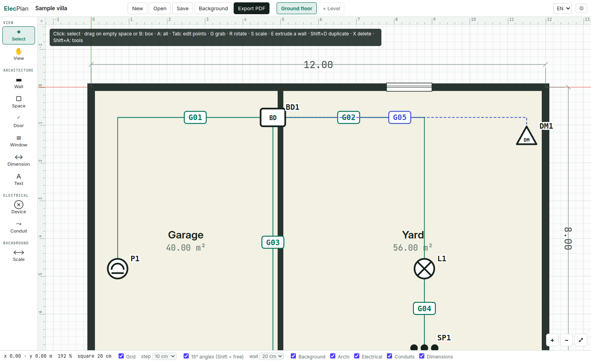
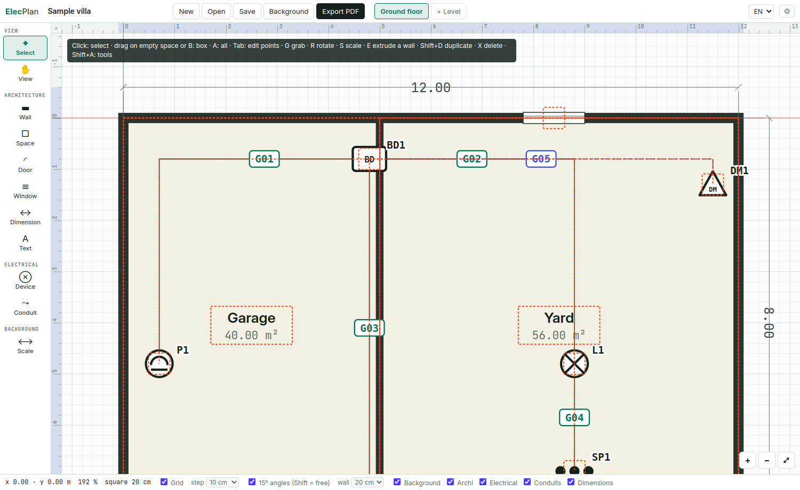
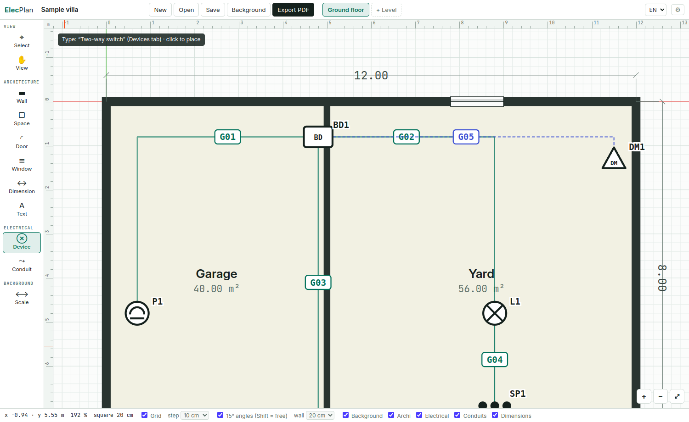
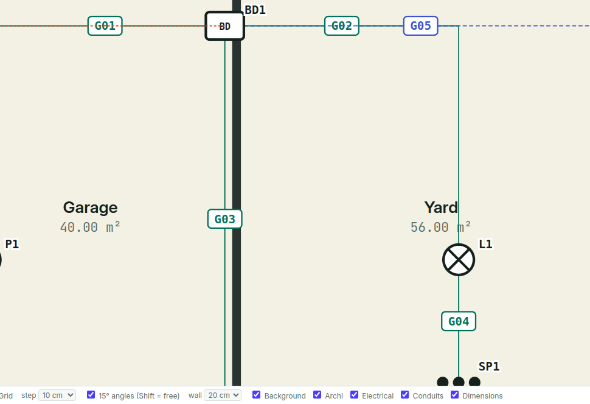
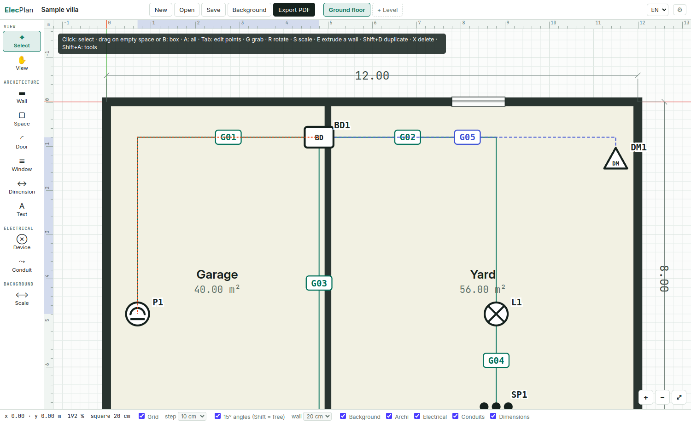
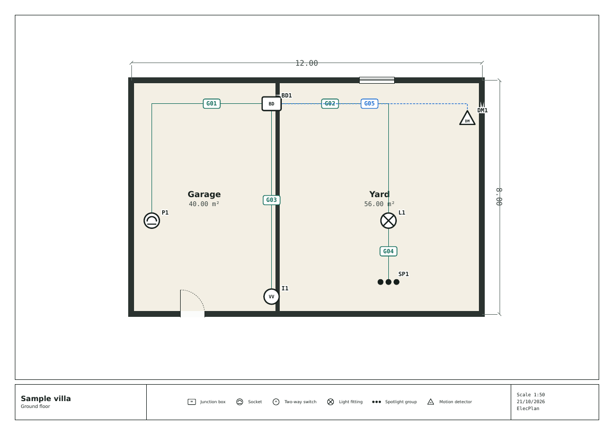
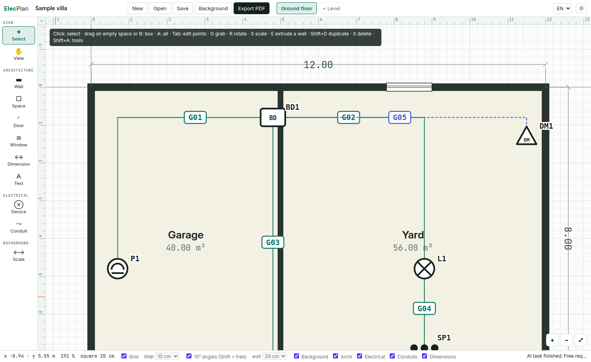

<!-- Source of the English manual. Build the PDF with `npm run manual` (see README.md in this folder).
     Keep manual.fr.md in step: same chapters, same order. -->

# Overview

## In short

ElecPlan draws a building plan (walls, spaces, doors, windows, dimensions) and then, on top of it, the electrical plan: referenced devices, junction boxes, numbered conduits and circuits. It produces a printable A3 plan, a bill of materials and, with the AI assistant, wiring proposals, a compliance check and a complete electrical file.

## Principles

- **Unit: the centimetre.** Coordinates, thicknesses and widths are in cm; lengths are displayed in metres.
- **Levels.** A project holds several levels (ground floor, upper floor, basement…), each with its own plan and background.
- **Unique references.** Every device gets an automatic reference (P1, I2, BD3…) that is unique across the project.
- **Conduits are numbered once and for all.** G01, G02… A number is never reassigned automatically.
- **Offline.** Drawing, files and exports work without Internet. Only the AI assistant uses Claude.
- **Bilingual.** The interface is available in English or French (see *The main screen*).

## The three layers of a plan

::: card
**Architecture** — Thick walls, spaces with their area and a movable label, doors and windows that snap to walls, dimensions, texts. A background plan (image or PDF) can be used as a tracing layer.
:::

::: card
**Electrical** — 17 device types (sockets, single / two-way / ON switches, detectors, light fittings, spotlights, junction boxes, panel, enclosure, RJ45…), each with circuit, mode, height and note.
:::

::: card
**Conduits** — Drawn from one device to another, with bends (straight or Bézier curves). Kind (power, low voltage, spare, outdoor), tube and content (wire codes).
:::

::: note
The AI assistant is optional: without Claude Code, every drawing and export feature is still available.
:::

# Installation

## Option A · Debian / Ubuntu package

```
sudo apt install ./elecplan_0.1.0_amd64.deb
```

The application appears in the menu as **ElecPlan**. To uninstall it: `sudo apt remove elecplan`.

## Option B · portable AppImage

```
chmod +x ElecPlan-0.1.0.AppImage
./ElecPlan-0.1.0.AppImage
```

No installation: the file runs as is, from a USB stick for example. Some recent distributions need `libfuse2` installed to run AppImages.

## Where is my data?

| Item | Location |
|-----|----------|
| Projects | wherever you save them (`.elecplan.json` files; older `.fpp.json` files open too) |
| Automatic recovery | the application's local storage, on every change |
| Settings (language, preferences, recent files, assistant) | `~/.config/ElecPlan/settings.json` |
| AI tasks | `~/.config/ElecPlan/jobs/<id>/` |

## AI assistant · Claude Code

To use the assistant, install Claude Code once (Node.js 18 or later required):

```
npm install -g @anthropic-ai/claude-code
claude
# in Claude Code: /login
```

Sign in with your Claude account (Pro or Max plan). ElecPlan then runs Claude Code in the background; it needs no key and stores none.

::: note
AI tasks count towards your Claude plan's usage limits, just like using Claude Code on the command line.
:::

Open the **AI assistant** tab to check: the “Claude Code” card should show ✅ and the detected version. Otherwise, see *Troubleshooting*.

## Development

```
npm install
npm start        # run from the sources
npm run manual   # build this manual (PDF + HTML)
npm run dist     # build .AppImage and .deb (also builds the manual)
```

# The main screen

<div class="annot"><span class="mk" style="left:6%;top:-7.5mm">1</span><span class="mk" style="left:22%;top:-7.5mm">2</span><span class="mk" style="left:47%;top:-7.5mm">3</span><span class="mk" style="left:3%;top:30%">4</span><span class="mk" style="left:40%;top:50%">5</span><span class="mk" style="left:83%;top:5.5%">6</span><span class="mk" style="left:30%;top:98%">7</span><span class="mk" style="left:73%;top:94%">8</span><span class="mk" style="left:95%;top:-7.5mm">9</span></div>

|   | Area | Purpose |
|-|----|--------------|
| 1 | Project name | Click to edit it. “● unsaved” means there are changes to save. |
| 2 | Files | New, Open, Save, Background, Export PDF. |
| 3 | Levels | One tab per level. Double-click to rename, “+ Level” to add one. |
| 4 | Tools | Select, view, architecture and electrical tools, and background scaling. <kbd>T</kbd> hides the toolbar. |
| 5 | Plan | Drawing area, with rulers in metres at the top and left (cursor in orange, selection in blue) and the X (red) and Y (green) axes through the origin. Middle-drag: pan; wheel or Ctrl + middle-drag: zoom. <kbd>Shift+A</kbd>: tools menu. |
| 6 | Panel | Properties of the selection, device library, bill of materials (Materials), AI assistant. <kbd>N</kbd> hides it. |
| 7 | Status bar | Coordinates, zoom, grid square size, grid and step, 15° angles, wall thickness, visible layers, messages. |
| 8 | Zoom | +, −, and ⤢ to fit everything. |
| 9 | Language and preferences | FR / EN switches the interface language immediately, without losing your work (also View → Language). On first launch, the language follows the system. ⚙ opens the preferences. |

## Preferences

**⚙** at the top right, <kbd>Ctrl+,</kbd> or Edit → Preferences. They apply to all projects and are kept between sessions:

- **Colours** of the interface, the plan (background, walls, space fill, device symbols, grid, axes) and each conduit kind;
- **Display**: rulers, scene axes, grid lines, zoom speed;
- **Values at startup and for new items**: wall thickness, grid step, snapping, 15° angles, door and window widths, position of a space's walls, area shown on labels.

↺ next to a changed value restores its factory value; “Reset all to factory defaults” restores them all.

# Getting started

::: steps
1. **Create the project.** Click “New”, then rename the project at the top left. Rename the “Ground floor” level if needed (double-click its tab).
2. **Import a background (optional).** “Background” → image or PDF. Then the **Scale** tool: click 2 points whose distance you know and enter it in metres.
3. **Draw the walls.** The **Wall** tool <kbd>W</kbd>: click each corner. Click the first point to close, or double-click / <kbd>Enter</kbd> to finish. Pick the thickness in the status bar.
4. **Define the spaces.** The **Space** tool <kbd>R</kbd>: drag from one inside corner to the other. Name it and set its width and height in Properties; tick “Add walls” (or <kbd>E</kbd>) to build its walls if you have not drawn them.
5. **Place doors and windows.** Tools <kbd>D</kbd> and <kbd>F</kbd>: hover over a wall and the opening snaps to it. <kbd>R</kbd> rotates the leaf, <kbd>Shift+R</kbd> flips it.
6. **Add dimensions.** The **Dimension** tool <kbd>C</kbd>: 2 clicks. Set the offset in Properties.
7. **Place the devices.** **Devices** tab: pick a type, then click on the plan. The reference is automatic. Fill in circuit and mode in Properties.
8. **Draw the conduits.** The **Conduit** tool <kbd>G</kbd>: click the start device (often a junction box), the bends, then the end device. Enter the content (R25.1, B25.1…).
9. **Check.** **Materials** tab for quantities and lengths; **AI assistant** tab → “Check compliance”.
10. **Save and export.** <kbd>Ctrl+S</kbd> to save the project, “Export PDF” for the A3 plan of each level.
:::

{width=80%}

# Architecture tools

| Tool | Key | How to use | Tips |
|---|--|--------|----------|
| Select | <kbd>V</kbd> | Click to select, drag to move. **Edit mode** (<kbd>Tab</kbd> or double-click) on a wall, space, conduit or dimension: click or box-select points, then G R S E X act on those points; <kbd>Tab</kbd> to go back. | **Several items:** drag on empty space or inside a space to draw a box (right: fully inside; left: touching). Shift+click adds or removes. <kbd>G</kbd> <kbd>R</kbd> <kbd>S</kbd> <kbd>E</kbd>, <kbd>Shift+D</kbd>, <kbd>X</kbd>, <kbd>A</kbd>, <kbd>B</kbd>: as in Blender (see *Keyboard shortcuts*). In Edit mode, double-click a segment: adds a point; a point: removes it. Arrows: move by the grid step (Shift: 50 cm). |
| View | — | Drag to pan the view. | At any time, as in Blender: middle-drag (or <kbd>Space</kbd> + drag). Ctrl + middle-drag or wheel: zoom at the cursor. Home: fit all. |
| Wall | <kbd>W</kbd> | Click point by point. To finish: double-click, <kbd>Enter</kbd>, right-click, or click the first point (closed wall). | Angles in 15° steps and lengths on the grid step; <kbd>Shift</kbd> for a free angle. Automatic snapping to existing vertices. **Exact length:** type it in metres (`3.4`), then <kbd>Enter</kbd>; `3.4<90` also sets the angle (0° = right, 90° = up). |
| Space | <kbd>R</kbd> | Drag from corner to corner (or click, then click): a rectangle. | Width and height in Properties while it stays rectangular (even rotated); other shapes in Edit mode. Creates no walls; see *Spaces* below. |
| Door | <kbd>D</kbd> | Hover over a wall, click to place (83 cm by default, see Preferences). | <kbd>R</kbd>: rotates the leaf; <kbd>Shift+R</kbd>: flips it. Snaps to the middle of the wall (between corners and joining walls) and shows the distances; “Centre on wall” in Properties. |
| Window | <kbd>F</kbd> | Hover over a wall, click to place (120 cm by default). | Aligns with the wall, takes its thickness and snaps to the middle, like the door. |
| Dimension | <kbd>C</kbd> | Click the 2 points to measure. | Positive or negative offset in Properties; the value follows the points. |
| Text | <kbd>Shift+Space</kbd> T | Click, then type. | Double-click with Select to edit. |
| Scale | — | 2 clicks on the background, then the real distance in metres. | Do this before drawing over an imported background. |

## Spaces

- **Walls:** the “Add walls” checkbox (or <kbd>E</kbd>) puts an ordinary closed wall around the space. Set its thickness and position: outside (the area stays the one drawn), centred on the outline, or inside. Changing the size, thickness or position rebuilds it from the outline. Untick to remove it.
- **Label:** the name and area form a separate label. Drag it, or use G / R / S to move, rotate or resize it; double-click to rename the space. “Show area” hides or shows the area. The label follows the space when it is moved, rotated or duplicated.

## Grid and snapping

“Grid” checkbox and step (5 to 50 cm) in the status bar; hold <kbd>Alt</kbd> while moving to ignore it. Zoomed out, the squares grow to 20 cm, 50 cm, 1 m… (size shown in the status bar), with darker lines on whole metres. **Precise point:** in a drawing tool, hold <kbd>Ctrl</kbd> before clicking: a marker shows where the click will land, a circle on a point of an item (corner, space centre, device, opening, bend, dimension end) or a cross on the grid, even with the grid unticked. With G, R or S, hold <kbd>Ctrl</kbd> to snap: G brings a corner, a space centre or a device onto a nearby point of another item, or else onto the grid.

## Layers

The Background, Archi, Electrical, Conduits and Dimensions checkboxes hide a layer on screen; a hidden item cannot be selected.

# Devices and circuits

{width=45%}

## Placing a device

1. **Devices** tab, click the type.
2. The **Device** tool is activated: click on the plan.
3. The reference is assigned: P for sockets, I for switches, L for light fittings, SP for spotlights, BD for junction boxes, DM for motion detectors… (the prefixes come from the French names and are the same in both languages).

## Device properties

| Field | Use |
|---|--------|
| Ref. | Editable; keep it unique |
| Type | Changes the symbol |
| Description | Free text (“Garage utility socket”) |
| Circuit | Chosen from the project circuits |
| Mode | S (single), VV (two-way), two-way master / slave, ON, DM, DM/ON, BP (push button) |
| Height | Mounting height in cm |
| Note | Site remark |

<kbd>R</kbd> rotates the selected device (type `90` then Enter for a quarter turn). <kbd>Shift+D</kbd> duplicates it with a new reference. Deleting a device also deletes its conduits (a message says so).

## Circuits

With nothing selected, the Properties panel lists the project circuits (name, rating, section, panel). “+ Circuit” adds one; they are offered in each device's properties.

# Conduits

## Drawing

1. The **Conduit** tool <kbd>G</kbd>.
2. Click the start device (panel, enclosure, junction box…).
3. Click for the bends.
4. Click the end device: the conduit is created with the next free number (G01, G02…).

<kbd>Esc</kbd> cancels the conduit being drawn. The ends follow the devices when they are moved.

## Editing

- <kbd>Tab</kbd> (or double-click the conduit): Edit mode. Drag a bend to move it, or pick it and press G.
- Double-click a segment: adds a bend; double-click a bend: removes it.
- **Curve:** Properties → Path → “Curve (Bézier)”. Each node gets two aligned round handles; drag them to bend the conduit. “Smooth” recalculates an even curve. The length shown is that of the curve.

{width=70%}

## Properties

| Field | Example |
|---|--------|
| Number | G07 (editable) |
| Kind | Power · Low voltage · Spare · Outdoor / buried |
| Tube | ICTA Ø25 |
| Content | R25.1, B25.1, T25.1 |

::: note
Recommended wire coding: letter (R phase, B neutral, T earth, J traveller, N switched return) + section (15 = 1.5 mm², 25 = 2.5 mm²) + network number. Same code from end to end, Wago connectors included.
:::

{width=45%}

# Background, levels and bill of materials

## Background plan

“Background” imports an image (PNG, JPG, WEBP) or the first page of a PDF. It is placed 20 m wide by default: use the **Scale** tool to give it the right size. Opacity is set in Properties (with nothing selected); “Remove” deletes it.

## Levels

“+ Level” adds a level; double-click a tab to rename it. Each level has its own walls, devices, conduits and background. References and conduit numbers stay unique across the project. The PDF exports one level per page.

## Bill of materials

The **Materials** tab gives:

- the number of devices per type and per level;
- the level's conduits (start, end, content, length on plan);
- the spaces and their areas.

“Export bill of materials (CSV)” produces a file for any spreadsheet (comma separator, decimal point). In French, the file uses semicolons and decimal commas.

{width=45%}

# Save, open, export

| Action | Shortcut | Result |
|----|---|---------|
| Save | <kbd>Ctrl+S</kbd> | Project file `.elecplan.json` (all data, background included) |
| Save as | <kbd>Ctrl+Shift+S</kbd> | New copy of the project |
| Open | <kbd>Ctrl+O</kbd> | Loads a project; offers to discard unsaved changes |
| Open Recent | File menu | The last 10 projects opened or saved; “Clear Recently Opened” empties the list |
| Export PDF | <kbd>Ctrl+P</kbd> | A3 landscape, one level per page, standard scale (1:20 to 1:1000), title block and legend of the symbols used |
| Export SVG | File menu | Vector plan of the current level, for drawing software |
| Bill of materials CSV | Materials tab | Devices and conduits of the whole project |

Exports (PDF, CSV) use the interface language and your colour preferences at the time of export.

{width=75%}

## Recovery

Every change is kept in local storage. The application always starts with an empty project; after a crash, File → “Recover Unsaved Work” reloads the last work. This does not replace saving the project. Quitting with unsaved changes asks you to “Save”, “Don’t save” or “Cancel”.

## Undo

<kbd>Ctrl+Z</kbd> undoes, <kbd>Ctrl+Shift+Z</kbd> or <kbd>Ctrl+Y</kbd> redoes (120 steps). An applied assistant proposal is also undone with a single <kbd>Ctrl+Z</kbd>.

## Sharing a project

The `.elecplan.json` file is readable JSON text: it can be sent, archived or processed by a script (see *Project file format*).

# AI assistant

## How it works

1. You pick a task and start it.
2. ElecPlan creates a task folder with `CONSIGNE.md` (the instructions), `projet.json` and, if needed, the image.
3. It runs `claude -p` in that folder, in the background. The log is shown live; you keep drawing.
4. Claude writes `resultat.json` (the proposal) and `rapport.md` (the report).
5. “Show result”, then “Apply”: the proposal is added to the current level (undo with <kbd>Ctrl+Z</kbd>).

Tasks run one at a time, in order. “Cancel” stops a task; “Folder” opens its working folder. When the interface is in English, Claude writes its report and notes in English; the trade conventions sent to it stay in French.

{width=45%}

## Security

- By default, Claude can only read and write files in the task folder; system commands are blocked.
- “Allow commands” (full-file task, or Settings) lets it produce a PDF, for example.
- The project sent does not include the background image (except the sketch task, which sends the chosen image).

## The five tasks

| Task | Input | Result | Tips |
|-----|-----|------|-----|
| **Read a sketch or photo** | An image; details (orientation, known dimensions, scale) | Walls, spaces, openings, devices, conduits to apply; report of assumptions | Sharp photo, taken straight on. Give one real dimension: the result will be to scale. |
| **Propose conduits and wiring** | The plan with its devices; instructions (junction boxes to use, required circuits); replace or complete | Conduits drawn and numbered, coded content, circuits, assignments; report (fill, Wago per box) | Place the panel and junction boxes first. Without “Replace”, existing conduits are kept. |
| **Generate the full electrical file** | The project; title, date, special points | dossier.html (and dossier.pdf if commands are allowed) in the task folder | If the “dossier-electrique-zone” skill is installed in Claude Code, its method is followed. |
| **Check compliance** | The project; priority points | Sorted list (blocking, important, advice) with fixes; “Show” button to locate | Run it before the final export. |
| **Free request** | Your request as text | Answer in the report; any changes to apply | E.g. “Add an IP44 socket next to each outside door”. |

## Settings

In the AI assistant tab → Settings: command to run (`claude` by default, or a full path), model (empty = Claude Code's default), permission to run commands for all tasks.

## Usage and plan

Tasks use the account signed in to Claude Code and count towards the plan's limits. A simple task takes a few seconds to a minute; a full electrical file can take several minutes.

## Conventions sent to Claude

2-pole type C breakers, 30 mA RCDs, solid H07V-U wires, ICTA Ø25 conduit (Ø30 for charging points) filled to one third at most, 16 A / 20 A on 2.5 mm² and 6–10 A on 1.5 mm², R/B/T/J/N codes + section + number, conduits never renumbered, Wago connectors in junction boxes and wherever a wire splits, through-wires kept continuous, looping on double terminals. They are written in `src/ai.js` and can be changed.

# Keyboard shortcuts

Shortcuts follow Blender where it makes sense.

| Key | Action |
|------|--------|
| <kbd>Middle-drag</kbd> / <kbd>Space</kbd> + drag | Pan the view |
| <kbd>Ctrl + middle-drag</kbd> / <kbd>Wheel</kbd> | Zoom |
| <kbd>Home</kbd> / <kbd>Numpad .</kbd> | Fit all / frame selection |
| <kbd>N</kbd> / <kbd>T</kbd> | Hide side panel / toolbar |
| <kbd>Shift+A</kbd> / <kbd>Shift+Space</kbd> | Tools and devices menu |
| <kbd>V W R D F C E G</kbd> | Nothing selected: select, wall, space, door, window, dimension, device, conduit |
| <kbd>Tab</kbd> | Object mode ↔ Edit mode (points of walls, spaces, conduits, dimensions) |
| <kbd>A</kbd> / <kbd>Alt+A</kbd> / <kbd>Ctrl+I</kbd> | Select all / deselect / invert |
| <kbd>B</kbd> / <kbd>Shift+click</kbd> | Box select / add, remove |
| <kbd>G</kbd> / <kbd>R</kbd> / <kbd>S</kbd> | Grab / rotate / scale: free; Ctrl snaps (nearby points or grid, 15°, 0.1); X / Y: axis; typed value |
| <kbd>E</kbd> | Extrude the selected wall; on a space: add its walls |
| <kbd>Shift+D</kbd> | Duplicate, then grab |
| <kbd>X</kbd> / <kbd>Del</kbd> | Delete the selection |
| <kbd>Enter</kbd> / <kbd>Esc</kbd> | Confirm / cancel (also left / right click) |
| <kbd>3.4</kbd> / <kbd>3.4<90</kbd> | Length (m) and angle while drawing a wall |
| <kbd>Arrows</kbd> | Move (Shift: 50 cm) |
| <kbd>Ctrl+Z</kbd> / <kbd>Ctrl+Shift+Z</kbd> | Undo / redo |
| <kbd>Ctrl+S</kbd> / <kbd>Ctrl+O</kbd> | Save / open |
| <kbd>Ctrl+,</kbd> | Preferences |
| <kbd>F12</kbd> / <kbd>Ctrl+P</kbd> | Export PDF |
| <kbd>Shift</kbd> (drawing) / <kbd>Alt</kbd> (moving) | Free angle / ignore grid |

# Troubleshooting

| Problem | Solution |
|-----|---------|
| “Claude Code not found” | Install it (`npm i -g @anthropic-ai/claude-code`). If it is installed elsewhere, put its full path in Settings (`which claude`). |
| The task fails immediately | Run `claude` in a terminal and do `/login`. Check the Internet connection. |
| “done (no output file)” | Claude wrote neither resultat.json nor rapport.md: run it again with a more precise request; check the log and the folder. |
| Usage limit reached | Wait for your plan to reset; drawing features remain available. |
| The AppImage won't start | Install `libfuse2`, or use the .deb package. |
| The PDF background is blurry | It is rendered at 3×; for more detail, export the page as a high-resolution image and import that. |
| An item can't be selected | Check that its layer is ticked in the status bar. |
| Symbols are too small | Properties (nothing selected) → Symbols → Size. |
| Colours or defaults look wrong | Preferences (⚙) → “Reset all to factory defaults”. |
| The interface is not in my language | FR / EN selector at the top right, or View → Language menu. |

# Project file format

An `.elecplan.json` project is readable JSON (older `.fpp.json` projects open too). Units in centimetres, origin at the top left, Y pointing down. Spaces are stored under `rooms`, their labels under `labels`, conduits under `gaines`.

```json
{
  "app": "ElecPlan", "version": 1, "name": "Sample villa",
  "settings": { "grid": 10, "symbol": 2 },
  "circuits": [ { "id": "c1", "name": "Lighting 1", "cal": "10A", "section": "1,5", "tableau": "TD" } ],
  "levels": [ {
    "id": "lv…", "name": "Ground floor", "elevation": 0,
    "background": { "src": "data:image/png;base64,…", "x": 0, "y": 0, "w": 2000, "h": 1400, "opacity": 0.5 },
    "walls":    [ { "id": "w…", "pts": [[0,0],[1200,0],[1200,800]], "thick": 20 } ],
    "rooms":    [ { "id": "r…", "name": "Garage", "pts": [[0,0],[500,0],[500,800],[0,800]] } ],
    "labels":   [ { "id": "l…", "space": "r…", "x": 250, "y": 400, "rot": 0, "size": 1, "area": true } ],
    "openings": [ { "id": "o…", "type": "door", "x": 250, "y": 800, "angle": 0, "w": 83, "flip": false } ],
    "dims":     [ { "id": "d…", "a": [0,0], "b": [1200,0], "offset": -60 } ],
    "texts":    [ { "id": "t…", "x": 100, "y": 100, "text": "Recess", "size": 18 } ],
    "devices":  [ { "id": "e…", "type": "prise_ip", "ref": "P1", "x": 60, "y": 450, "rot": 0,
                    "label": "IP44 socket", "circuit": "c2", "mode": "", "height": "30", "note": "" } ],
    "gaines":   [ { "id": "g…", "num": "G01", "a": "e…(BD1)", "b": "e…(P1)", "pts": [[60,70]],
                    "kind": "pwr", "tube": "ICTA Ø25", "content": "R25.1, B25.1, T25.1" } ]
  } ]
}
```

A wall built for a space also carries `"space": "r…"` and `"spacePos": "out" | "mid" | "in"`. A curved conduit carries `"curve": true` and its handles in `"h"`.

::: card
**Device types** — prise, prise_ip, prise_spe, inter_s, inter_vv, inter_on, poussoir, dm, lum, applique, spots, bd, tableau, coffret, equip, rj45, reserve. The keys are French and identical in both languages (prise = socket, inter = switch, poussoir = push button, lum = light fitting, bd = junction box, tableau = panel, coffret = enclosure, reserve = spare).
:::

::: card
**Conduit kinds** — pwr (power), lv (low voltage), res (spare), ext (outdoor / buried). Each conduit links two devices by their `id`; `pts` holds only the bends.
:::

## Planned for future versions

DXF import, single-line diagram, automatic space dimensioning, custom layers.
