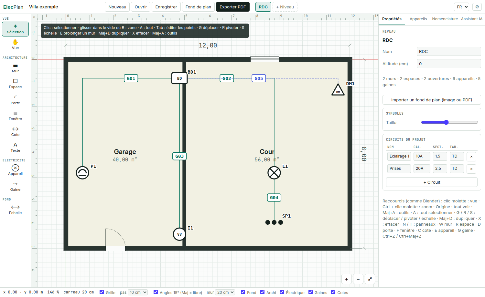
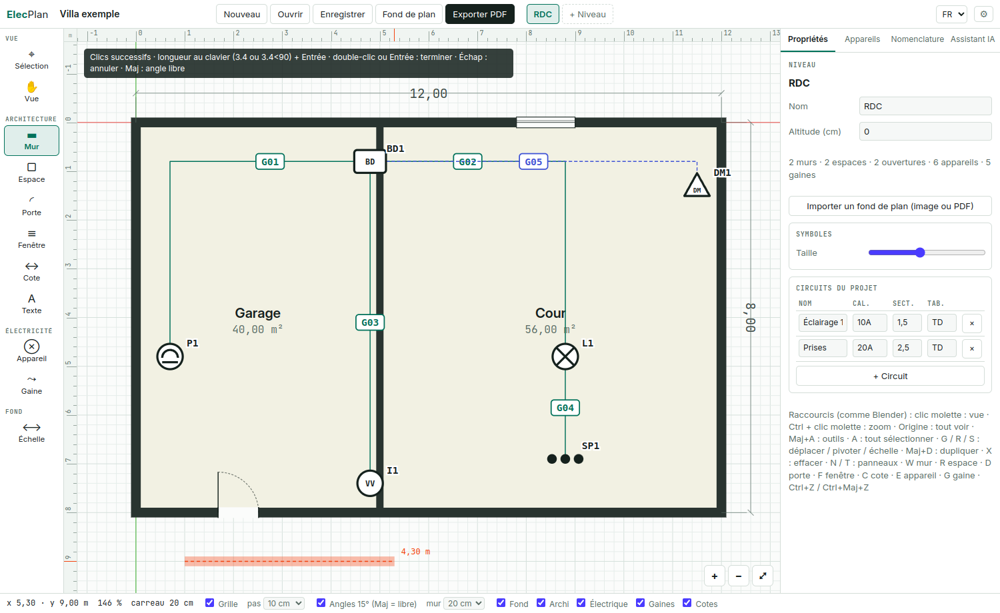
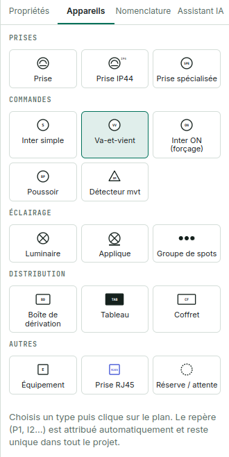
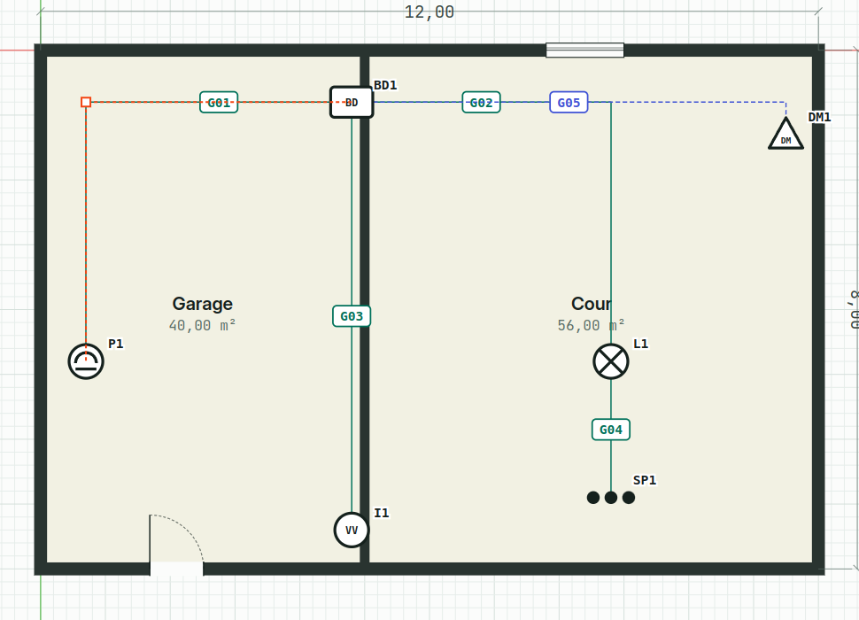
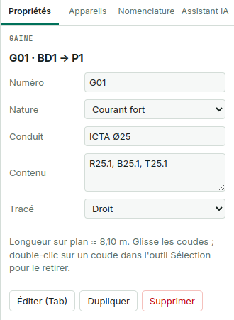
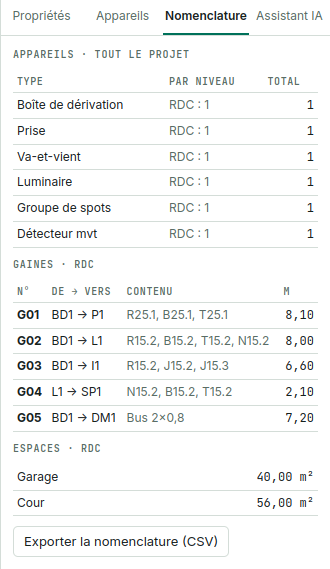
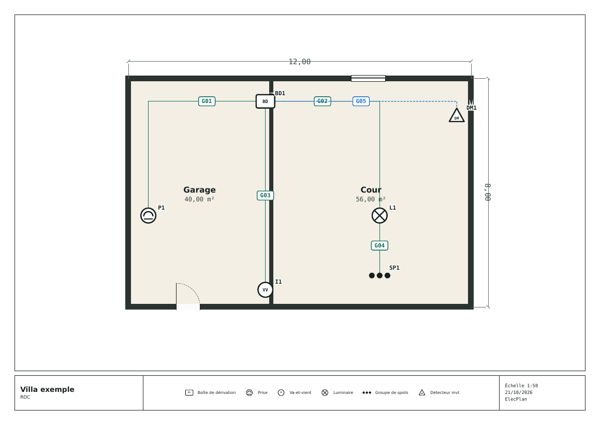
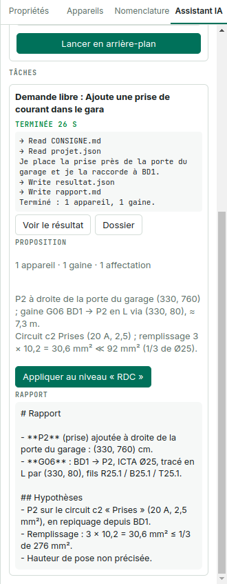

<!-- Source du manuel français. Le PDF se construit avec `npm run manual` (voir README.md dans ce dossier).
     Garder manual.en.md en phase : mêmes chapitres, même ordre. -->

# Présentation

## En bref

ElecPlan dessine le plan d'un bâtiment (murs, espaces, portes, fenêtres, cotes) puis, par-dessus, le plan électrique : appareils repérés, boîtes de dérivation, gaines numérotées et circuits. Il produit un plan A3 imprimable, une nomenclature et, avec l'assistant IA, des propositions de câblage, un contrôle de conformité et un dossier complet.

## Principes

- **Unité : le centimètre.** Les coordonnées, épaisseurs et largeurs sont en cm ; l'affichage des longueurs est en mètres.
- **Niveaux.** Un projet contient plusieurs niveaux (RDC, étage, cave…), chacun avec son plan et son fond.
- **Repères uniques.** Chaque appareil reçoit un repère automatique (P1, I2, BD3…) unique dans tout le projet.
- **Gaines numérotées une fois pour toutes.** G01, G02… Un numéro n'est jamais réattribué automatiquement.
- **Hors ligne.** Le dessin, les fichiers et les exports fonctionnent sans Internet. Seul l'assistant IA utilise Claude.
- **Bilingue.** Interface en anglais ou en français, au choix (voir *L'écran principal*).

## Les trois couches d'un plan

::: card
**Architecture** — Murs épais, espaces avec surface et étiquette déplaçable, portes et fenêtres collées aux murs, cotes, textes. Un fond de plan (image ou PDF) peut servir de calque.
:::

::: card
**Électricité** — 17 types d'appareils (prises, inters S / VV / ON, détecteurs, luminaires, spots, BD, tableau, coffret, RJ45…), chacun avec circuit, mode, hauteur et note.
:::

::: card
**Gaines** — Tracées d'un appareil à un autre, avec coudes (droites ou courbes de Bézier). Nature (courant fort, faible, réserve, extérieur), conduit et contenu (codes de fils).
:::

::: note
L'assistant IA est facultatif : sans Claude Code, toutes les fonctions de dessin et d'export restent disponibles.
:::

# Installation

## Option A · paquet Debian / Ubuntu

```
sudo apt install ./elecplan_0.1.0_amd64.deb
```

L'application apparaît dans le menu sous le nom **ElecPlan**. Pour la désinstaller : `sudo apt remove elecplan`.

## Option B · AppImage portable

```
chmod +x ElecPlan-0.1.0.AppImage
./ElecPlan-0.1.0.AppImage
```

Aucune installation : le fichier se lance tel quel, depuis une clé USB par exemple. Sur certaines distributions récentes, il faut installer `libfuse2` pour les AppImage.

## Où sont mes données ?

| Élément | Emplacement |
|-----|----------|
| Projets | là où tu les enregistres (fichiers `.elecplan.json` ; les anciens `.fpp.json` s'ouvrent aussi) |
| Récupération automatique | mémoire locale de l'application, à chaque modification |
| Réglages (langue, préférences, fichiers récents, assistant) | `~/.config/ElecPlan/settings.json` |
| Tâches IA | `~/.config/ElecPlan/jobs/<id>/` |

## Assistant IA · Claude Code

Pour utiliser l'assistant, installe Claude Code une seule fois (Node.js 18 ou plus récent requis) :

```
npm install -g @anthropic-ai/claude-code
claude
# dans Claude Code : /login
```

Connecte-toi avec ton compte Claude (abonnement Pro ou Max). ElecPlan lance ensuite Claude Code en arrière-plan ; il n'a besoin d'aucune clé et n'en stocke aucune.

::: note
Les tâches IA comptent dans les limites d'usage de ton abonnement Claude, comme une utilisation de Claude Code en ligne de commande.
:::

Pour vérifier, ouvre l'onglet **Assistant IA** : la carte « Claude Code » doit afficher ✅ et la version détectée. Sinon, voir *Dépannage*.

## Développement

```
npm install
npm start        # lancer depuis les sources
npm run manual   # construire ce manuel (PDF + HTML)
npm run dist     # construire .AppImage et .deb (construit aussi le manuel)
```

# L'écran principal

<div class="annot"><span class="mk" style="left:6%;top:-7.5mm">1</span><span class="mk" style="left:22%;top:-7.5mm">2</span><span class="mk" style="left:52.5%;top:-7.5mm">3</span><span class="mk" style="left:3%;top:30%">4</span><span class="mk" style="left:40%;top:50%">5</span><span class="mk" style="left:83%;top:5.5%">6</span><span class="mk" style="left:30%;top:98%">7</span><span class="mk" style="left:73%;top:94%">8</span><span class="mk" style="left:95%;top:-7.5mm">9</span></div>

|   | Zone | Rôle |
|-|----|--------------|
| 1 | Nom du projet | Clique pour le modifier. « ● non enregistré » signale des changements à enregistrer. |
| 2 | Fichiers | Nouveau, Ouvrir, Enregistrer, Fond de plan, Exporter PDF. |
| 3 | Niveaux | Un onglet par niveau. Double-clic pour renommer, « + Niveau » pour en ajouter. |
| 4 | Outils | Sélection, vue, outils d'architecture, d'électricité et mise à l'échelle du fond. <kbd>T</kbd> masque la barre d'outils. |
| 5 | Plan | Zone de dessin, avec règles en mètres en haut et à gauche (curseur en orange, sélection en bleu) et axes X (rouge) et Y (vert) à l'origine. Clic molette glissé : déplacer la vue ; molette ou Ctrl + clic molette : zoom. <kbd>Maj+A</kbd> : menu des outils. |
| 6 | Panneau | Propriétés de la sélection, bibliothèque d'appareils, nomenclature, assistant IA. <kbd>N</kbd> le masque. |
| 7 | Barre d'état | Coordonnées, zoom, taille des carreaux, grille et pas, angles 15°, épaisseur des murs, couches visibles, messages. |
| 8 | Zoom | +, −, et ⤢ pour tout voir. |
| 9 | Langue et préférences | FR / EN change la langue de l'interface immédiatement, sans perdre le travail en cours (aussi Affichage → Langue). Au premier lancement, la langue suit celle du système. ⚙ ouvre les préférences. |

## Préférences

**⚙** en haut à droite, <kbd>Ctrl+,</kbd> ou Édition → Préférences. Elles valent pour tous les projets et sont gardées d'une session à l'autre :

- **Couleurs** de l'interface, du plan (fond, murs, remplissage des espaces, symboles, grille, axes) et de chaque nature de gaine ;
- **Affichage** : règles, axes de la scène, lignes de la grille, vitesse du zoom ;
- **Valeurs au démarrage et pour les nouveaux éléments** : épaisseur des murs, pas de la grille, accrochage, angles 15°, largeurs des portes et fenêtres, position des murs d'un espace, surface sur les étiquettes.

↺ à côté d'une valeur modifiée remet sa valeur d'usine ; « Tout remettre aux valeurs d'usine » les remet toutes.

# Prise en main

::: steps
1. **Créer le projet.** Clique « Nouveau », puis renomme le projet en haut à gauche. Renomme le niveau « RDC » si besoin (double-clic sur l'onglet).
2. **Importer un fond (facultatif).** « Fond de plan » → image ou PDF. Puis outil **Échelle** : clique 2 points dont tu connais la distance et saisis-la en mètres.
3. **Tracer les murs.** Outil **Mur** <kbd>W</kbd> : clique chaque angle. Clique sur le premier point pour fermer, ou double-clic / <kbd>Entrée</kbd> pour finir. Choisis l'épaisseur dans la barre d'état.
4. **Définir les espaces.** Outil **Espace** <kbd>R</kbd> : glisse d'un angle intérieur à l'autre. Nomme-le et règle largeur et hauteur dans Propriétés ; coche « Ajouter les murs » (ou <kbd>E</kbd>) pour construire ses murs si tu ne les as pas tracés.
5. **Poser portes et fenêtres.** Outils <kbd>D</kbd> et <kbd>F</kbd> : survole un mur, l'ouverture s'y colle. <kbd>R</kbd> tourne le battant, <kbd>Maj+R</kbd> l'inverse.
6. **Coter.** Outil **Cote** <kbd>C</kbd> : 2 clics. Règle le décalage dans Propriétés.
7. **Placer les appareils.** Onglet **Appareils** : choisis un type puis clique sur le plan. Le repère est automatique. Renseigne circuit et mode dans Propriétés.
8. **Tracer les gaines.** Outil **Gaine** <kbd>G</kbd> : clique l'appareil de départ (souvent une BD), les coudes, puis l'appareil d'arrivée. Saisis le contenu (R25.1, B25.1…).
9. **Contrôler.** Onglet **Nomenclature** pour les quantités et longueurs ; onglet **Assistant IA** → « Vérifier la conformité ».
10. **Enregistrer et exporter.** <kbd>Ctrl+S</kbd> pour enregistrer le projet, « Exporter PDF » pour le plan A3 de chaque niveau.
:::

{width=80%}

# Outils d'architecture

| Outil | Touche | Utilisation | Astuces |
|---|--|--------|----------|
| Sélection | <kbd>V</kbd> | Clic pour sélectionner, glisser pour déplacer. **Mode édition** (<kbd>Tab</kbd> ou double-clic) sur un mur, un espace, une gaine ou une cote : clic ou zone pour choisir des points, puis G R S E X agissent sur ces points ; <kbd>Tab</kbd> pour revenir. | **Plusieurs éléments :** glisse dans le vide ou dans un espace pour tracer une zone (vers la droite : entièrement dedans ; vers la gauche : touché). Maj+clic ajoute ou retire. <kbd>G</kbd> <kbd>R</kbd> <kbd>S</kbd> <kbd>E</kbd>, <kbd>Maj+D</kbd>, <kbd>X</kbd>, <kbd>A</kbd>, <kbd>B</kbd> : comme dans Blender (voir *Raccourcis clavier*). En édition, double-clic sur un tronçon : ajoute un point ; sur un point : le retire. Flèches : déplacer du pas (Maj : 50 cm). |
| Vue | — | Glisser pour déplacer la vue. | À tout moment, comme dans Blender : glisser avec le clic molette (ou <kbd>Espace</kbd> + glisser). Ctrl + clic molette ou molette : zoom au curseur. Origine : tout voir. |
| Mur | <kbd>W</kbd> | Clics successifs. Fin : double-clic, <kbd>Entrée</kbd>, clic droit, ou clic sur le premier point (mur fermé). | Angles par pas de 15° et longueurs au pas de grille ; <kbd>Maj</kbd> pour un angle libre. Accrochage automatique aux sommets existants. **Longueur exacte :** tape-la en mètres (`3.4`) puis <kbd>Entrée</kbd> ; `3.4<90` fixe aussi l'angle (0° = droite, 90° = haut). |
| Espace | <kbd>R</kbd> | Glisser d'un angle à l'autre (ou clic, puis clic) : un rectangle. | Largeur et hauteur dans Propriétés tant qu'il reste rectangulaire (même tourné) ; autres formes en mode édition. Ne crée pas de murs ; voir *Espaces* ci-dessous. |
| Porte | <kbd>D</kbd> | Survole un mur, clic pour poser (83 cm par défaut, voir Préférences). | <kbd>R</kbd> : tourne le battant ; <kbd>Maj+R</kbd> : inverse. S'aimante au milieu du mur (entre angles et murs raccordés) et affiche les distances ; « Centrer sur le mur » dans Propriétés. |
| Fenêtre | <kbd>F</kbd> | Survole un mur, clic pour poser (120 cm par défaut). | S'aligne sur le mur, prend son épaisseur et s'aimante au milieu, comme la porte. |
| Cote | <kbd>C</kbd> | 2 clics sur les points à coter. | Décalage positif ou négatif dans Propriétés ; la valeur suit les points. |
| Texte | <kbd>Maj+Espace</kbd> T | Clic puis saisie. | Double-clic en Sélection pour modifier. |
| Échelle | — | 2 clics sur le fond de plan, puis distance réelle en mètres. | À faire avant de dessiner sur un fond importé. |

## Espaces

- **Murs :** la case « Ajouter les murs » (ou <kbd>E</kbd>) pose un mur fermé ordinaire autour de l'espace. Règle son épaisseur et sa position : extérieur (la surface reste celle tracée), dans l'axe du contour, ou intérieur. Changer la taille, l'épaisseur ou la position le recalcule depuis le contour. Décocher l'enlève.
- **Étiquette :** le nom et la surface forment une étiquette à part. Glisse-la, ou G / R / S pour la déplacer, la tourner ou la redimensionner ; double-clic pour renommer l'espace. « Afficher la surface » masque ou affiche la surface. L'étiquette suit l'espace quand on le déplace, le tourne ou le duplique.

## Grille et accrochage

Case « Grille » et pas (5 à 50 cm) dans la barre d'état ; maintiens <kbd>Alt</kbd> pendant un déplacement pour l'ignorer. En dézoomant, les carreaux passent à 20 cm, 50 cm, 1 m… (taille affichée dans la barre d'état), avec des lignes foncées sur les mètres ronds. **Point précis :** dans un outil de dessin, maintiens <kbd>Ctrl</kbd> avant de cliquer : un repère montre où tombera le clic, un cercle sur un point d'un élément (angle, centre d'espace, appareil, ouverture, coude, extrémité de cote) ou une croix sur la grille, même grille décochée. Avec G, R ou S, maintiens <kbd>Ctrl</kbd> pour accrocher : G amène un angle, le centre d'un espace ou un appareil sur un point proche d'un autre élément, sinon sur la grille.

## Couches

Les cases Fond, Archi, Électrique, Gaines et Cotes masquent une couche à l'écran ; un élément masqué ne peut pas être sélectionné.

# Appareils et circuits

{width=45%}

## Poser un appareil

1. Onglet **Appareils**, clic sur le type.
2. L'outil **Appareil** s'active : clique sur le plan.
3. Le repère est attribué : P pour les prises, I pour les inters, L pour les luminaires, SP pour les spots, BD pour les boîtes, DM pour les détecteurs…

## Propriétés d'un appareil

| Champ | Usage |
|---|--------|
| Repère | Modifiable ; garde-le unique |
| Type | Change le symbole |
| Désignation | Texte libre (« Prise service garage ») |
| Circuit | Choisi dans les circuits du projet |
| Mode | S, VV, VV maître / esclave, ON, DM, DM/ON, BP |
| Hauteur | Hauteur de pose en cm |
| Note | Remarque de chantier |

<kbd>R</kbd> fait pivoter l'appareil sélectionné (tape `90` puis Entrée pour un quart de tour). <kbd>Maj+D</kbd> le duplique avec un nouveau repère. Supprimer un appareil supprime aussi ses gaines (un message l'indique).

## Circuits

Sans sélection, le panneau Propriétés liste les circuits du projet (nom, calibre, section, tableau). « + Circuit » en ajoute un ; ils sont proposés dans la fiche de chaque appareil.

# Gaines

## Tracer

1. Outil **Gaine** <kbd>G</kbd>.
2. Clic sur l'appareil de départ (tableau, coffret, BD…).
3. Clics pour les coudes.
4. Clic sur l'appareil d'arrivée : la gaine est créée avec le numéro suivant libre (G01, G02…).

<kbd>Échap</kbd> annule le tracé en cours. Les extrémités suivent les appareils quand on les déplace.

## Modifier

- <kbd>Tab</kbd> (ou double-clic sur la gaine) : mode édition. Glisser un coude pour le déplacer, ou le choisir puis G.
- Double-clic sur un tronçon : ajoute un coude ; double-clic sur un coude : le retire.
- **Courbe :** Propriétés → Tracé → « Courbe (Bézier) ». Chaque nœud reçoit deux poignées rondes, alignées ; glisse-les pour courber la gaine. « Lisser » recalcule une courbe régulière. La longueur affichée est celle de la courbe.

{width=70%}

## Propriétés

| Champ | Exemple |
|---|--------|
| Numéro | G07 (modifiable) |
| Nature | Courant fort · Courant faible · Réserve · Extérieur / enterré |
| Conduit | ICTA Ø25 |
| Contenu | R25.1, B25.1, T25.1 |

::: note
Convention de codage conseillée : lettre (R phase, B neutre, T terre, J navette, N retour) + section (15 = 1,5 mm², 25 = 2,5 mm²) + numéro de réseau. Même code de bout en bout, Wago compris.
:::

{width=45%}

# Fond de plan, niveaux et nomenclature

## Fond de plan

« Fond de plan » importe une image (PNG, JPG, WEBP) ou la première page d'un PDF. Il est posé à 20 m de large par défaut : utilise l'outil **Échelle** pour le mettre aux bonnes dimensions. L'opacité se règle dans Propriétés (sans sélection) ; « Retirer » le supprime.

## Niveaux

« + Niveau » ajoute un niveau ; double-clic sur un onglet pour le renommer. Chaque niveau a ses murs, appareils, gaines et son fond. Les repères et numéros de gaines restent uniques sur tout le projet. Le PDF exporte un niveau par page.

## Nomenclature

L'onglet **Nomenclature** donne :

- le nombre d'appareils par type et par niveau ;
- la liste des gaines du niveau (départ, arrivée, contenu, longueur sur plan) ;
- les espaces et leurs surfaces.

« Exporter la nomenclature (CSV) » produit un fichier lisible dans un tableur (séparateur point-virgule, virgule décimale).

{width=45%}

# Enregistrer, ouvrir, exporter

| Action | Raccourci | Résultat |
|----|---|---------|
| Enregistrer | <kbd>Ctrl+S</kbd> | Fichier projet `.elecplan.json` (toutes les données, fond compris) |
| Enregistrer sous | <kbd>Ctrl+Maj+S</kbd> | Nouvelle copie du projet |
| Ouvrir | <kbd>Ctrl+O</kbd> | Charge un projet ; propose d'abandonner les changements non enregistrés |
| Ouvrir un fichier récent | menu Fichier | Les 10 derniers projets ouverts ou enregistrés ; « Effacer la liste » la vide |
| Exporter PDF | <kbd>Ctrl+P</kbd> | A3 paysage, un niveau par page, échelle normalisée (1:20 à 1:1000), cartouche et légende des symboles utilisés |
| Exporter SVG | menu Fichier | Plan vectoriel du niveau courant, pour un logiciel de dessin |
| Nomenclature CSV | onglet Nomenclature | Appareils et gaines de tout le projet |

Les exports (PDF, CSV) sont rédigés dans la langue de l'interface et avec tes préférences de couleurs au moment de l'export.

{width=75%}

## Récupération

Chaque modification est gardée en mémoire locale. L'application démarre toujours sur un projet vide ; après un plantage, Fichier → « Récupérer le travail non enregistré » recharge le dernier travail. Cela ne remplace pas l'enregistrement du projet. En quittant avec des modifications non enregistrées, ElecPlan propose « Enregistrer », « Ne pas enregistrer » ou « Annuler ».

## Annuler

<kbd>Ctrl+Z</kbd> annule, <kbd>Ctrl+Maj+Z</kbd> ou <kbd>Ctrl+Y</kbd> rétablit (120 étapes). Une proposition de l'assistant appliquée s'annule aussi d'un seul <kbd>Ctrl+Z</kbd>.

## Échanger un projet

Le fichier `.elecplan.json` est un texte JSON lisible : il peut être envoyé, archivé ou traité par un script (voir *Format du fichier projet*).

# Assistant IA

## Comment ça marche

1. Tu choisis une tâche et tu la lances.
2. ElecPlan crée un dossier de tâche avec `CONSIGNE.md`, `projet.json` et, si besoin, l'image.
3. Il lance `claude -p` dans ce dossier, en arrière-plan. Le journal s'affiche en direct ; tu continues à dessiner.
4. Claude écrit `resultat.json` (proposition) et `rapport.md`.
5. « Voir le résultat », puis « Appliquer » : la proposition est ajoutée au niveau courant (annulable par <kbd>Ctrl+Z</kbd>).

Les tâches passent une par une, dans l'ordre. « Annuler » arrête une tâche ; « Dossier » ouvre son dossier de travail. En anglais, Claude rédige son rapport et ses notes en anglais ; les consignes métier qui lui sont transmises restent en français.

{width=45%}

## Sécurité

- Par défaut, Claude ne peut que lire et écrire des fichiers dans le dossier de la tâche ; les commandes système sont interdites.
- « Autoriser les commandes » (tâche Dossier, ou Réglages) permet par exemple de produire un PDF.
- Le projet envoyé n'inclut pas l'image de fond (sauf la tâche Croquis, qui envoie l'image choisie).

## Les cinq tâches

| Tâche | À fournir | Résultat | Conseils |
|-----|-----|------|-----|
| **Lire un croquis ou une photo** | Une image ; précisions (orientation, cotes connues, échelle) | Murs, espaces, ouvertures, appareils, gaines à appliquer ; rapport des hypothèses | Photo nette, de face. Indique une cote réelle : la reconstitution sera à la bonne échelle. |
| **Proposer gaines et câblage** | Le plan avec ses appareils ; consignes (BD à utiliser, circuits imposés) ; remplacer ou compléter | Gaines tracées et numérotées, contenu codé, circuits, affectations ; rapport (remplissage, Wago par boîte) | Place d'abord tableau et BD. Sans « Remplacer », les gaines existantes sont gardées. |
| **Générer le dossier complet** | Le projet ; titre, date, points particuliers | dossier.html (et dossier.pdf si commandes autorisées) dans le dossier de la tâche | Si la skill « dossier-electrique-zone » est installée dans Claude Code, sa méthode est suivie. |
| **Vérifier la conformité** | Le projet ; points prioritaires | Liste classée (bloquant, important, conseil) avec correction ; bouton « Voir » pour localiser | À lancer avant l'export final. |
| **Demande libre** | Ta demande en texte | Réponse dans le rapport ; modifications éventuelles à appliquer | Ex. : « Ajoute une prise IP44 à côté de chaque porte extérieure ». |

## Réglages

Dans l'onglet Assistant IA → Réglages : commande à lancer (par défaut `claude`, ou chemin complet), modèle (vide = celui de Claude Code), autorisation des commandes pour toutes les tâches.

## Usage et abonnement

Les tâches utilisent le compte connecté dans Claude Code et comptent dans les limites de l'abonnement. Une tâche simple prend de quelques secondes à une minute ; un dossier complet peut prendre plusieurs minutes.

## Conventions transmises à Claude

Disjoncteurs 2P courbe C, ID 30 mA, fils rigides H07V-U, ICTA Ø25 (Ø30 borne) rempli au plus au tiers, 16 A / 20 A en 2,5 et 6–10 A en 1,5, codes R/B/T/J/N + section + numéro, gaines jamais renumérotées, Wago dans les BD et là où un fil se divise, fil traversant continu, repiquage sur borne double. Elles sont écrites dans `src/ai.js` et modifiables.

# Raccourcis clavier

Les raccourcis suivent Blender quand c'est pertinent.

| Touche | Action |
|------|--------|
| <kbd>Clic molette</kbd> / <kbd>Espace</kbd> + glisser | Déplacer la vue |
| <kbd>Ctrl + clic molette</kbd> / <kbd>Molette</kbd> | Zoom |
| <kbd>Origine</kbd> / <kbd>Pavé .</kbd> | Tout voir / cadrer la sélection |
| <kbd>N</kbd> / <kbd>T</kbd> | Masquer le panneau / la barre d'outils |
| <kbd>Maj+A</kbd> / <kbd>Maj+Espace</kbd> | Menu des outils et appareils |
| <kbd>V W R D F C E G</kbd> | Sans sélection : sélection, mur, espace, porte, fenêtre, cote, appareil, gaine |
| <kbd>Tab</kbd> | Mode objet ↔ mode édition (points des murs, espaces, gaines, cotes) |
| <kbd>A</kbd> / <kbd>Alt+A</kbd> / <kbd>Ctrl+I</kbd> | Tout sélectionner / désélectionner / inverser |
| <kbd>B</kbd> / <kbd>Maj+clic</kbd> | Sélection par zone / ajouter, retirer |
| <kbd>G</kbd> / <kbd>R</kbd> / <kbd>S</kbd> | Déplacer / pivoter / mettre à l'échelle : libres ; Ctrl accroche (points proches ou grille, 15°, 0,1) ; X / Y : axe ; valeur au clavier |
| <kbd>E</kbd> | Prolonger le mur sélectionné ; sur un espace : ajouter ses murs |
| <kbd>Maj+D</kbd> | Dupliquer puis déplacer |
| <kbd>X</kbd> / <kbd>Suppr</kbd> | Supprimer la sélection |
| <kbd>Entrée</kbd> / <kbd>Échap</kbd> | Valider / annuler (aussi clic gauche / clic droit) |
| <kbd>3.4</kbd> / <kbd>3.4<90</kbd> | Longueur (m) et angle pendant le tracé d'un mur |
| <kbd>Flèches</kbd> | Déplacer (Maj : 50 cm) |
| <kbd>Ctrl+Z</kbd> / <kbd>Ctrl+Maj+Z</kbd> | Annuler / rétablir |
| <kbd>Ctrl+S</kbd> / <kbd>Ctrl+O</kbd> | Enregistrer / ouvrir |
| <kbd>Ctrl+,</kbd> | Préférences |
| <kbd>F12</kbd> / <kbd>Ctrl+P</kbd> | Exporter PDF |
| <kbd>Maj</kbd> (tracé) / <kbd>Alt</kbd> (déplacement) | Angle libre / sans grille |

# Dépannage

| Problème | Solution |
|-----|---------|
| « Claude Code introuvable » | Installe-le (`npm i -g @anthropic-ai/claude-code`). S'il est installé ailleurs, mets son chemin complet dans Réglages (`which claude`). |
| La tâche échoue tout de suite | Lance `claude` dans un terminal et fais `/login`. Vérifie la connexion Internet. |
| « terminée (sans fichier de sortie) » | Claude n'a pas écrit resultat.json ni rapport.md : relance avec une demande plus précise ; consulte le journal et le dossier. |
| Limite d'usage atteinte | Attends la réinitialisation de ton abonnement ; les fonctions de dessin restent disponibles. |
| L'AppImage ne démarre pas | Installe `libfuse2`, ou utilise le paquet .deb. |
| Le fond PDF est flou | Il est rendu à 3× ; pour plus de détail, exporte la page en image haute définition et importe l'image. |
| Un élément ne se sélectionne pas | Vérifie que sa couche est cochée dans la barre d'état. |
| Les symboles sont trop petits | Propriétés (sans sélection) → Symboles → Taille. |
| Couleurs ou valeurs par défaut étranges | Préférences (⚙) → « Tout remettre aux valeurs d'usine ». |
| L'interface n'est pas dans ma langue | Sélecteur FR / EN en haut à droite, ou menu Affichage → Langue. |

# Format du fichier projet

Un projet `.elecplan.json` est un JSON lisible (les anciens projets `.fpp.json` s'ouvrent aussi). Unités en centimètres, origine en haut à gauche, Y vers le bas. Les espaces sont enregistrés sous `rooms`, leurs étiquettes sous `labels`, les gaines sous `gaines`.

```json
{
  "app": "ElecPlan", "version": 1, "name": "Villa exemple",
  "settings": { "grid": 10, "symbol": 2 },
  "circuits": [ { "id": "c1", "name": "Éclairage 1", "cal": "10A", "section": "1,5", "tableau": "TD" } ],
  "levels": [ {
    "id": "lv…", "name": "RDC", "elevation": 0,
    "background": { "src": "data:image/png;base64,…", "x": 0, "y": 0, "w": 2000, "h": 1400, "opacity": 0.5 },
    "walls":    [ { "id": "w…", "pts": [[0,0],[1200,0],[1200,800]], "thick": 20 } ],
    "rooms":    [ { "id": "r…", "name": "Garage", "pts": [[0,0],[500,0],[500,800],[0,800]] } ],
    "labels":   [ { "id": "l…", "space": "r…", "x": 250, "y": 400, "rot": 0, "size": 1, "area": true } ],
    "openings": [ { "id": "o…", "type": "door", "x": 250, "y": 800, "angle": 0, "w": 83, "flip": false } ],
    "dims":     [ { "id": "d…", "a": [0,0], "b": [1200,0], "offset": -60 } ],
    "texts":    [ { "id": "t…", "x": 100, "y": 100, "text": "Niche", "size": 18 } ],
    "devices":  [ { "id": "e…", "type": "prise_ip", "ref": "P1", "x": 60, "y": 450, "rot": 0,
                    "label": "Prise IP44", "circuit": "c2", "mode": "", "height": "30", "note": "" } ],
    "gaines":   [ { "id": "g…", "num": "G01", "a": "e…(BD1)", "b": "e…(P1)", "pts": [[60,70]],
                    "kind": "pwr", "tube": "ICTA Ø25", "content": "R25.1, B25.1, T25.1" } ]
  } ]
}
```

Un mur construit pour un espace porte aussi `"space": "r…"` et `"spacePos": "out" | "mid" | "in"`. Une gaine courbe porte `"curve": true` et ses poignées dans `"h"`.

::: card
**Types d'appareils** — prise, prise_ip, prise_spe, inter_s, inter_vv, inter_on, poussoir, dm, lum, applique, spots, bd, tableau, coffret, equip, rj45, reserve.
:::

::: card
**Nature des gaines** — pwr (courant fort), lv (courant faible), res (réserve), ext (extérieur / enterré). Une gaine relie deux appareils par leur `id` ; `pts` contient seulement les coudes.
:::

## Prévu dans les prochaines versions

Import DXF, schéma unifilaire, cotation automatique des espaces, calques personnalisés.
